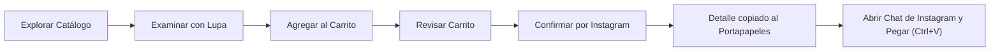

# Embrollitos MaLu ☕✨
### Catálogo Digital y Carrito de Compras para Redes Sociales

Aplicación web frontend moderna, ágil y responsiva para **Embrollitos MaLu** (tienda de artículos personalizados, sublimación, bazar y merchandising).

El objetivo principal de la plataforma es brindar a los clientes una experiencia de compra fluida: explorar el catálogo de artículos, examinarlos en alta resolución con lupa interactiva, armar su carrito y generar un resumen listo para copiar y enviar directamente por **Instagram Direct** para coordinar diseño, pago y entrega.

🌐 **Sitio Web Oficial**: [www.embrollitosmalu.com.ar](https://www.embrollitosmalu.com.ar)

---

## 📌 Tabla de Contenidos

1. [Características Principales](#-características-principales)
2. [Flujo de Compra](#-flujo-de-compra)
3. [Estructura del Proyecto](#-estructura-del-proyecto)
4. [Tecnologías Utilizadas](#-tecnologías-utilizadas)
5. [Instalación y Ejecución Local](#-instalación-y-ejecución-local)
6. [Despliegue](#-despliegue)
7. [Consideraciones de Arquitectura](#-consideraciones-de-arquitectura)

---

## 🚀 Características Principales

- **Catálogo Interactivo**:
  - Búsqueda en tiempo real por nombre, descripción o categoría.
  - Filtrado por categorías (Tazas, Sublimables varios, etc.).
  - Ordenamiento por precio (menor a mayor / mayor a menor) y alfabético (A-Z).
  - Normalización inteligente de datos (compatibilidad con precios numéricos o formateados).

- **Lupa y Visor Ampliado de Producto**:
  - Botón de lupa accesible en cada tarjeta del catálogo.
  - Modal lightbox de alta resolución con zoom dinámico 2.4x centrado en la posición del cursor (zoom lens interactivo).
  - Compatible con dispositivos de escritorio (mouse) y móviles/tablets (gestos táctiles).
  - Posibilidad de agregar al carrito directamente desde el visor.

- **Carrito de Compras (Drawer Lateral)**:
  - Panel lateral deslizante accesible con atajo de teclado (`Esc`).
  - Control de unidades (+ / -), eliminación individual y vaciado total.
  - Persistencia automática de los artículos en el navegador utilizando `LocalStorage`.
  - Notificaciones flotantes (toasts) que confirman cada acción del usuario.

- **Confirmación y Envío Directo a Instagram**:
  - No requiere pasarelas de pago invasivas ni registro de usuarios.
  - Al presionar **Confirmar Pedido por Instagram**, el detalle formateado se copia automáticamente al portapapeles.
  - Se abre un modal con el resumen de la compra, un visor del texto preparado y un botón directo para abrir el chat de Instagram (`@embrollitos.malu`) y pegar el pedido.

---

## 🛍️ Flujo de Compra



1. **Selección**: El usuario navega el catálogo, filtra y suma productos a su carrito.
2. **Confirmación**: Abre el carrito lateral y hace clic en **"Confirmar Pedido por Instagram"**.
3. **Copia asistida**: La aplicación compila la lista de productos y monto total, copiándola al portapapeles.
4. **Coordinación en Instagram**: El usuario presiona el botón **"Abrir Chat de Instagram"**, pega el mensaje en la conversación y coordina diseño personalizado y medio de pago directamente con el comercio.

---

## 📂 Estructura del Proyecto

```text
javier_sosa_utn_progra_3/
│
├── index.html              # Estructura semántica principal (HTML5 accesible)
├── CNAME                   # Configuración de dominio personalizado
├── productos.json          # Catálogo de datos en formato JSON
│
├── css/
│   └── styles.css          # Estilos modulares, variables CSS y diseño responsivo
│
├── js/
│   ├── main.js             # Lógica del catálogo, filtros, carrito, lupa y portapapeles
│   └── productos.js        # Datos del catálogo para carga estática offline
│
└── productos/              # Imágenes optimizadas de los artículos sublimables
```

---

## 🛠️ Tecnologías Utilizadas

- **HTML5 Semántico**:
  - Maquetación con etiquetas estándar (`<header>`, `<nav>`, `<main>`, `<section>`, `<article>`, `<aside>`, `<footer>`).
  - Cumplimiento de normas de accesibilidad (ARIA labels, roles de diálogo, badges y contraste de color).
- **CSS3 Puro**:
  - Variables CSS (`:root`) para consistencia en la paleta de colores y espaciados.
  - Modelos de maquetación modernos mediante **CSS Grid** y **Flexbox**.
  - Efectos visuales de desenfoque (`backdrop-filter`) y animaciones fluidas aceleradas por hardware.
  - Diseño 100% responsivo adaptable a pantallas móviles, tablets y monitores.
- **Vanilla JavaScript (ES6+)**:
  - Cero dependencias o frameworks pesados.
  - Asincronía con `async/await` y consumo dinámico mediante `Fetch API`.
  - Persistencia de sesión a través de `localStorage` (`JSON.stringify` y `JSON.parse`).
  - `Clipboard API` con alternativa para asegurar compatibilidad en todos los navegadores.

---

## 💻 Instalación y Ejecución Local

No requiere la instalación de gestores de paquetes como npm o bundlers. Para ejecutarlo localmente:

1. Clonar el repositorio:
   ```bash
   git clone https://github.com/tu-usuario/javier_sosa_utn_progra_3.git
   ```
2. Acceder al directorio:
   ```bash
   cd javier_sosa_utn_progra_3
   ```
3. Abrir con cualquier servidor local (por ejemplo con la extensión **Live Server** de VS Code o mediante Python):
   ```bash
   # En Python 3
   python -m http.server 8000
   ```
4. Ingresar a `http://localhost:8000` en tu navegador web.

---

## 🌐 Despliegue

La plataforma está diseñada como un sitio estático optimizado, ideal para ser alojado en plataformas como:
- **GitHub Pages**
- **Vercel**
- **Netlify**
- **Servidores Web convencionales (Apache, Nginx)**

Actualmente se encuentra vinculado al dominio `www.embrollitosmalu.com.ar` mediante el archivo `CNAME`.

---

## 📝 Consideraciones de Arquitectura

- **Sin backend complejo**: La arquitectura desacoplada y sin base de datos en servidor reduce los costos operativos a cero y elimina riesgos de seguridad de almacenamiento de credenciales.
- **Redes Sociales como canal de conversión**: Al descentralizar el pago y acordar los pedidos por Instagram, el negocio mantiene un trato cercano y personalizado para definir los detalles de sublimación y personalización de cada producto antes de cobrar.

---

© 2026 **Embrollitos MaLu**. Todos los derechos reservados.
